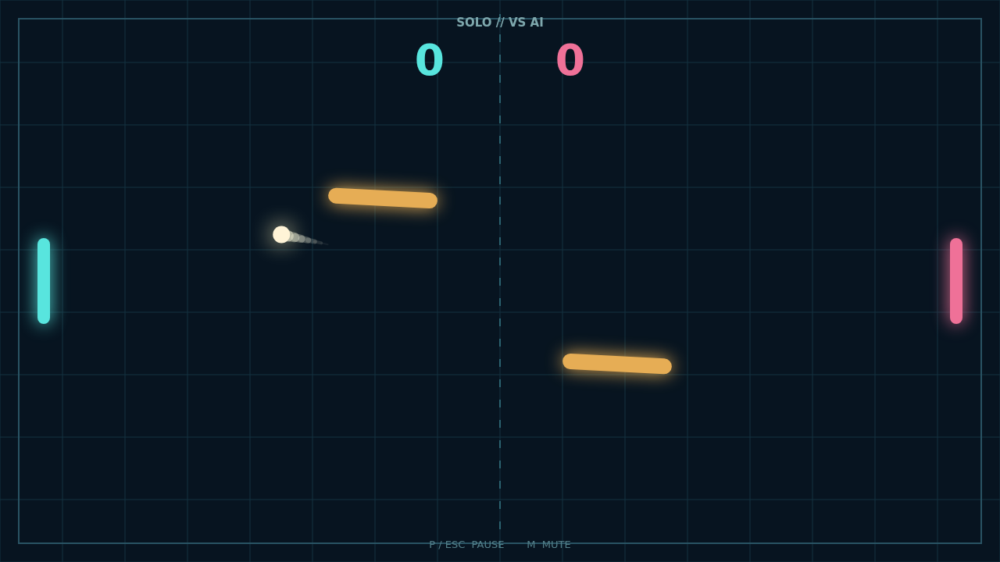

# Carom

The ball waits at center court. You take the first return, aiming past the two golden obstacles that sway and turn between the paddles. Every rally starts cleanly, then becomes a new problem as the bars change angle.

Meet the ball while your paddle is moving and it takes on spin. A straight return starts to arc, making a familiar line of play bend toward the edge. A good shot can curl around an obstacle; a daring one banks off its tilted face and changes direction midcourt.

Play Solo against an AI that tracks incoming shots, or bring a second player to the keyboard for Versus. The first side to reach 11 with a two-point lead wins, so a close match can keep going beyond match point.

